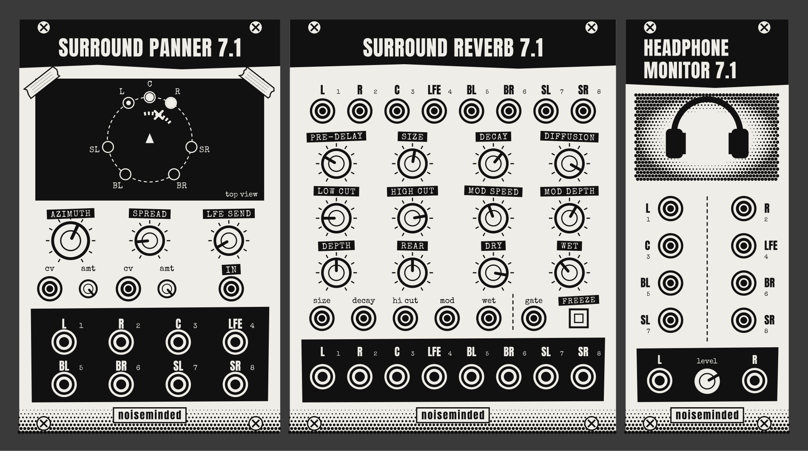

# Surround Panner 7.1

Three [VCV Rack 2](https://vcvrack.com) modules by **Noiseminded** for working with a 7.1 speaker system.



**Surround Panner 7.1** pans a sound around the room.

- Turn one knob (or send one CV) to move a sound around the room.
- Equal-power panning between neighbouring speakers, so the loudness stays constant while the sound moves.
- **Spread** widens a sound from a single point to the whole room.
- **LFE send** feeds a low-passed copy to the subwoofer.
- Polyphonic: every voice of a polyphonic cable can have its own position.
- A live top view of the room shows where each voice is and which speakers are playing.
- Speaker angles can be adjusted to match the real room.

**Surround Reverb 7.1** puts a plate reverb around the whole room.

- A plate reverb after Jon Dattorro's classic design (the same family as the well-known Plateau), extended to 7.1.
- Every speaker gets its own reverb tail, read from a different place in the reverb, so the room sounds wide instead of collapsing into the middle.
- Patch it between the panner and Audio 8: the 8 channels go in, dry plus reverb come out in the same order.
- Depth adds pre-delay towards the back of the room; Rear moves the reverb between front and back. Freeze holds the tail forever.

**Headphone Monitor 7.1** lets you hear a 7.1 patch on headphones.

- Takes the same 8 channels you send to the speakers.
- Renders each speaker from its direction using measured head-related impulse responses, then mixes to stereo.
- Use it to build and check patches at home; judge the final result in the room.

Made for the *Imagem e Som Interativos* course, but free for anyone to use.

## Install

1. Open the [latest release](https://github.com/Noiseminded/surround-panner_7.1/releases/latest) and download the file for your computer:

   | Computer | File ends in |
   |---|---|
   | Windows | `win-x64.vcvplugin` |
   | Mac with Apple Silicon (M1 or later) | `mac-arm64.vcvplugin` |
   | Mac with Intel processor | `mac-x64.vcvplugin` |
   | Linux | `lin-x64.vcvplugin` |

   On a Mac, check which one you have under  → About This Mac. If Rack runs under Rosetta, use the `mac-x64` file.

2. In VCV Rack, choose **Help → Open user folder**. Put the downloaded file in the plugins folder there. In recent versions of Rack this folder has your system in its name, for example `plugins-win-x64` or `plugins-mac-arm64`.
3. Restart Rack. Right-click an empty space in the rack and search for **Noiseminded**.

Rack unpacks the file itself at startup, so do not unzip it. To update, replace the old `.vcvplugin` file with the new one and restart Rack.

## Patching it to the speakers

Add a **VCV Audio 8** module, select the room's audio interface, and connect the panner's outputs:

| Panner output | Audio 8 input (common 7.1 order) |
|---|---|
| L | 1 |
| R | 2 |
| C | 3 |
| LFE | 4 |
| BL | 5 |
| BR | 6 |
| SL | 7 |
| SR | 8 |

The small number next to each output on the panel is this channel. If your room is wired in a different order, patch each output to the jack of the matching speaker instead. Always check with a test sound first.

## Adding reverb

Put **Surround Reverb 7.1** between the panner and Audio 8: panner outputs into the reverb's inputs (same names, same numbers), reverb outputs into Audio 8. Several panners can share one reverb if you mix them first.

To use it as a send instead (dry signal patched straight to the speakers elsewhere), turn **DRY** down to zero.

## Previewing on headphones

Add a **Headphone Monitor 7.1** and connect the same 8 signals you send to Audio 8 (stack a second cable on each output). Connect its L and R outputs to a stereo Audio module for your headphones. Its inputs use the same numbers as the panner's outputs.

What to expect: left, right and movement come across clearly. Front and back are often ambiguous on headphones, because everyone's ears are different and the measurements come from a dummy head. Some people hear sounds "inside the head". Use the monitor to build and check your patch, then listen in the room.

If you changed the speaker angles on the panner, set the same angles on the monitor (right-click → Speaker angles).

## Controls

### Surround Panner 7.1

| Control | What it does |
|---|---|
| **AZIMUTH** | Direction of the sound in degrees. 0° is front centre, +90° is to the right, ±180° is directly behind. |
| **AZIMUTH CV + AMT** | Adds to the knob. 10 V = one full turn (360°), so a 0–10 V saw LFO makes the sound circle the room once per cycle. Turn AMT negative to reverse the direction. |
| **SPREAD** | 0%: a sharp point source between two speakers. 100%: the sound fills the whole circle. |
| **SPREAD CV + AMT** | Adds to the knob. 10 V = 100%. |
| **LFE SEND** | How much of the input goes to the LFE output, low-passed (120 Hz by default). Start low. |
| **IN** | Audio input, mono or polyphonic. |

Right-click menu:

- **Speaker angles**: move each speaker to match the real room, or reset to the 7.1 standard (L/R ±30°, sides ±100°, backs ±145°) or to an even circle.
- **Use centre speaker for panning**: turn off to keep the centre speaker silent; front sounds then come from L and R together.
- **Mix polyphonic voices to mono outputs** (on by default): each output carries one channel, ready for Audio 8. Turn off to keep the voices separate on polyphonic outputs.
- **LFE low-pass**: 80, 100 or 120 Hz.

### Surround Reverb 7.1

| Control | What it does |
|---|---|
| **L R C LFE BL BR SL SR in** | The 7.1 bus, for example from the panner. Left-side speakers feed one half of the reverb, right-side speakers the other, the centre feeds both. |
| **PRE-DELAY** | Gap before the reverb starts, 0 to 500 ms. |
| **SIZE** | Size of the plate, 25% to 200%. Turning it while sound plays bends the pitch of the tail, which can be used as an effect. |
| **DECAY** | How long the tail lasts. Near the top it rings for a very long time. |
| **DIFFUSION** | How quickly the reverb becomes smooth. Lower values let early echoes through. |
| **LOW CUT / HIGH CUT** | Filters inside the reverb (20 Hz to 1 kHz, 500 Hz to 20 kHz). High cut darkens the tail as it decays. |
| **MOD SPEED / MOD DEPTH** | Slow pitch modulation inside the reverb, for a lusher, less metallic tail. |
| **DEPTH** | Extra pre-delay for the sides (up to 15 ms) and backs (up to 30 ms), so the room feels deep. |
| **REAR** | 50%: reverb even all around. Lower: more in front. Higher: more behind, like film mixes. |
| **DRY / WET** | Levels of the original and reverb signals. The LFE passes through at the dry level, with no reverb. |
| **FREEZE** | Button or gate: holds the current tail forever and ignores new input. |
| **CV inputs** | Size, decay, high cut, modulation depth and wet. 10 V covers the knob's whole range. |

Right-click menu: **Clear the reverb tail**.

### Headphone Monitor 7.1

| Control | What it does |
|---|---|
| **L R C LFE BL BR SL SR** | The 8 speaker signals. Polyphonic cables are summed. |
| **LEVEL** | Output level, up to +6 dB. A sound from the centre speaker comes out at about the same level in each ear. |
| **L / R out** | Stereo signal for headphones. |

Right-click menu: **Speaker angles**, the same as on the panner.

## How it works

The seven full-range speakers form a ring. For a sound at a given angle, only the two speakers either side of it play. Their gains follow the equal-power law: `cos` and `sin` of the position between them, so at the halfway point both play at about 71% (−3 dB) and the total power stays the same. Spread is made by splitting the sound into 16 points across the chosen width and adding up their power, so a wide sound still keeps a constant level. The LFE output never takes part in panning: bass below about 120 Hz has almost no direction.

The reverb follows the figure-eight plate design from Jon Dattorro's "Effect Design, Part 1" (J. Audio Eng. Soc., 1997): the input is smeared by four allpass filters, then circulates in a loop of two cross-coupled halves with delays, damping and modulated allpasses. Dattorro reads a stereo output from seven points spread around the loop. Here each of the seven speakers reads its own seven points, with same-side points added and far-side points subtracted, so every speaker's tail is different (the tests check that the correlation between any two speakers stays low).

The headphone monitor convolves each speaker signal with a pair of head-related impulse responses, one per ear, measured for that direction on a KEMAR dummy head. Directions between the measured 5° steps are interpolated. The LFE channel goes to both ears equally.

## Building from source

You need the [VCV Rack SDK](https://vcvrack.com/manual/Building#Building-Rack-plugins).

```sh
export RACK_DIR=/path/to/Rack-SDK
make install
```

The pan law, the reverb and the headphone renderer have their own tests, which need only a C++ compiler:

```sh
make -C tests
```

The panel artwork is generated by `tools/make_panels.py` (needs `pip install fonttools`), and the head-related impulse response table by `tools/make_hrtf.py`.

New releases are built for all platforms by GitHub Actions when a version tag is pushed. The tag must match the version in `plugin.json`, for example `v2.1.0`.

## Credits and licenses

- Code: GPL-3.0-or-later. See [LICENSE.txt](LICENSE.txt).
- Head-related impulse responses: MIT Media Lab KEMAR measurements by Bill Gardner and Keith Martin (1994), provided without usage restrictions. Tables converted by Aristotel Digenis in [mit-hrtf-lib](https://github.com/zodsoft/mit-hrtf-lib), MIT License (see [LICENSE-mit-hrtf-lib.txt](LICENSE-mit-hrtf-lib.txt)).
- Fonts: [Anton](https://fonts.google.com/specimen/Anton) (SIL Open Font License) and [Special Elite](https://fonts.google.com/specimen/Special+Elite) (Apache License 2.0), in `res/fonts` with their licenses.
